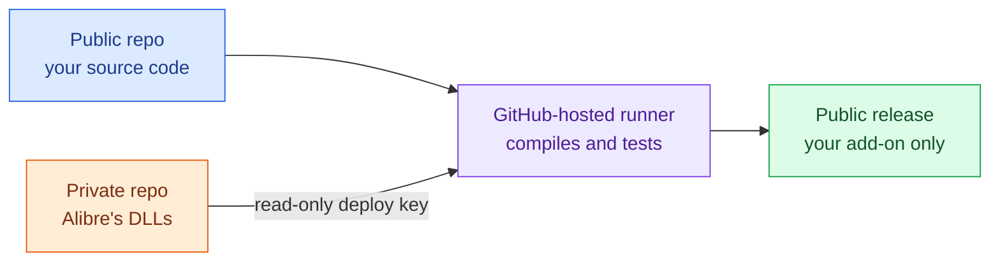
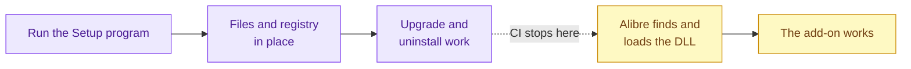
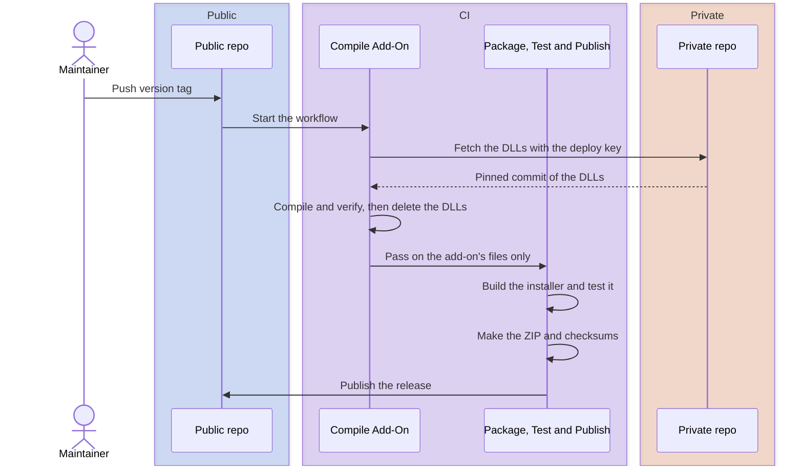
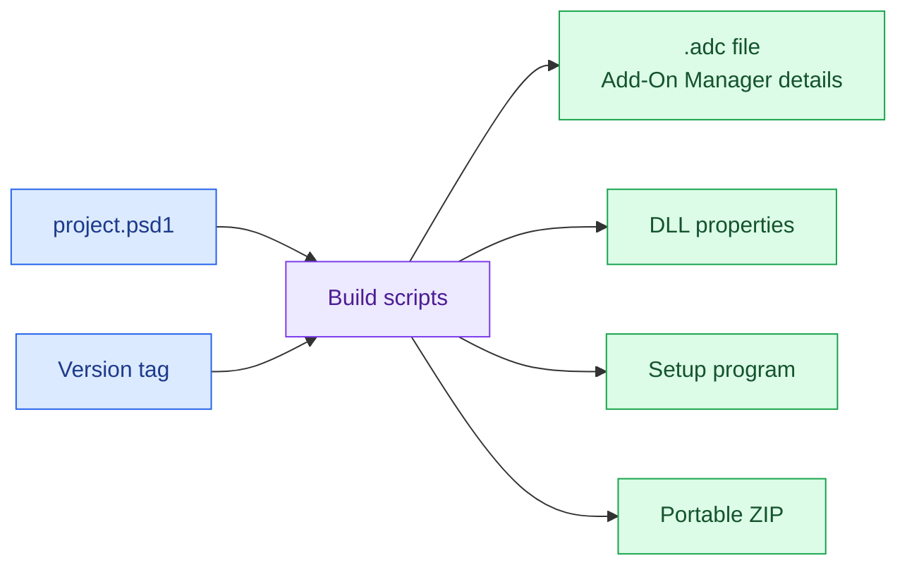

# How the build system works

This repository demonstrates how to build and release an Alibre Design add-on with GitHub Actions, using GitHub's own hosted machines, which are free for public repositories.

## The Problem

To compile, an add-on needs files that ship with Alibre Design, such as `AlibreX.dll`. That causes some problems:

- GitHub's Windows machines ("runners") don't have Alibre installed, so they don't have those files.
- It's not practical to install Alibre on a GitHub "runner", because there is no stable/supported way of activating the license without human involvement.
- The proprietary DLLs are not yours to publish - Alibre only wants them to be available to users with an Alibre license. So including them in a public open-source add-on repository would be violating Alibre's license terms.

The usual approach to this, on a small scale, is for the developer of the add-on to simply perform all the builds on their local machine, with a licensed/activated copy of Alibre (which means they have the necessary DLLs). While this technically works, it is has some major downsides:
* It's annoyingly manual for developers to create new Releases of the add-on. The process can be tedious and error-prone, especially if things like version metadata need to be incorporated into the add-on.
* The add-on is not necessarily built in a "sterile" environment - other factors on the developer's local machine could "contaminate" the released binaries and cause unexpected issues. This is a general principle of modern software development, not an Alibre-specific issue.
* It scales very poorly to open-source add-ons with many contributors. There may be 6 people who contributed code to a release, but one person still has to run the final build to generate the releaseable binaries.
* It doesn't allow any automated building or testing on pull requests (other folks' contributions to the code). Automated builds, in this context, give an early "litmus test" of the code changes being proposed.

## This Boilerplate's Approach

In this demonstration repository, the proprietary DLLs live in a separate **private repository**, used only for building. Only the build job can read it, using a read-only key.

If you publish multiple Alibre add-ons, you can use _one_ private repository to serve this purpose for all your add-on repositories. You can also store DLLs from several versions of Alibre in this repository (providing that you have the licenses for each version), which makes it easy to compile add-ons for specific versions of Alibre.

With this approach, we're able to achieve modern automated builds of the software and automated testing, _without_ violating Alibre's license terms (because the proprietary DLLs are accessible to the secure "runner" machines performing the build, but _not_ exposed to the general public).

The diagrams in this guide share one color scheme:

| Color | Meaning |
|---|---|
| 🟦 Blue | Public: your source code, and anyone can see it |
| 🟧 Orange | Private: Alibre's files and the key that reads them |
| 🟪 Purple | Work done by CI |
| 🟩 Green | What users receive |
| 🟨 Yellow | Checks you do by hand, in Alibre |



## What runs and when

CI first checks whether the run can see two secrets: the deploy key, and the private repository's name. That decides
which track it follows.

| Trigger | Sees the secrets? | What happens | Publishes anything? |
|---|---|---|---|
| External pull request, from a fork | No | Tests the installer with a placeholder DLL | No |
| Dependabot pull request | No | Tests the installer with a placeholder DLL | No |
| Internal pull request, from a branch in this repository | Yes, once set up | Compiles the real add-on, then tests the installer with it | No |
| Push to `main` | Yes, once set up | Same as an internal pull request | No |
| Version tag, such as `v1.2.3` | Required | Compiles, packages and tests the real add-on, then publishes it | Yes, if every step passes |

A new copy of this repository has no secrets yet, so it follows the placeholder track until you
[set up compiling](#setting-up-compiling-in-ci). Its CI passes from the first push, and there are no repository names
to change in the workflows.

```mermaid
flowchart TD
    subgraph pr_track ["Placeholder track"]
        pr["No key: external pull<br/>request, or not set up yet"]:::public --> placeholder["Build the placeholder DLL"]:::ci
        placeholder --> pr_test["Installer Test<br/>with the placeholder DLL"]:::ci
    end

    subgraph main_track ["Full track"]
        push["Push to main, or internal<br/>pull request from a branch"]:::public --> fetch["Fetch Alibre's DLLs<br/>using the key"]:::private
        fetch --> build["Compile Add-On"]:::ci
        build --> main_test["Installer Test<br/>with the real DLL"]:::ci
    end

    style pr_track fill:#64748B22,stroke:#64748B
    style main_track fill:#64748B22,stroke:#64748B
    classDef public fill:#DBEAFE,stroke:#2563EB,color:#1E3A8A
    classDef private fill:#FFEDD5,stroke:#EA580C,color:#7C2D12
    classDef ci fill:#EDE9FE,stroke:#7C3AED,color:#4C1D95
```



These tracks are separate: a run on the placeholder track never uses a DLL built by the full track.

## Why external pull requests can't run the full track

**Building a pull request runs that pull request's code.** It can change the workflows and scripts, and a project
file can run any command during a compile. The full track also needs the key, so anything that runs there could
copy the key or Alibre's DLLs and send them anywhere.

Anyone on GitHub can open a pull request from a fork. Giving those pull requests the key would give everyone
access to the private repository, so GitHub withholds repository secrets from them by default. Don't work around
that.

Internal pull requests can run the full track because they don't add any risk. Anyone who can push a branch to
this repository already has write access, so they could reach the key anyway. Dependabot's pull requests are the
exception: they come from a branch here, but
[GitHub treats them like forks](https://docs.github.com/en/code-security/dependabot/troubleshooting-dependabot/troubleshooting-dependabot-on-github-actions)
and withholds repository secrets from them too, so they use the placeholder track.

To run a contributor's change through the full track:

1. Read all of it, especially any changes to workflows, scripts and project files.
2. Push their branch to a new branch in this repository, and open an internal pull request from it.

Merging to `main` also runs the full track, but by then the change is already in.

## What the Installer Test checks

**The Installer Test tests the installer, not the add-on.** CI runs the real Setup program on a clean Windows runner, then checks what it did to the machine. The test confirms that:

- The expected files are in the correct folder under `%ProgramData%\Alibre AddOns\`.
- The registry value Alibre looks for is in the 64-bit view, and points to that folder.
- Windows' Installed apps list shows the right name and version.
- Installing again over an existing copy, as an upgrade does, leaves all of that correct.
- Uninstalling removes all of that, and leaves other add-ons' registry values alone.

An installer only copies the DLL to the right place, it never loads it, so this test works with any DLL. The placeholder track uses a **placeholder DLL**, a tiny file built from `scripts/placeholder/Placeholder.cs` that _does not_ require any of the proprietary Alibre DLLs to build. This means the "installer test" track _doesn't_ need access to the private repository where the proprietary Alibre DLLs live.

The full track and releases test the real DLL (and has the necessary access to the private repository to pull that off).

**It stops there.** The runner doesn't have Alibre, so nothing ever loads the DLL, even the real one. None of these tests can tell you whether the add-on _actually works in Alibre_ - you have to check that yourself. But these tests eliminate the need for you as the add-on developer to verify every detail of the installer's behavior at every release.



## How a release works

Add a `## [X.Y.Z]` section to `CHANGELOG.md`, push it to `main`, and run
`scripts/publish-release.ps1 -Version X.Y.Z`. CI does the rest, and versions starting with `0.` are marked as
pre-releases. [RELEASING.md](RELEASING.md) walks through each step.



If any step fails, nothing is published, and you can delete the tag and try again. Once a version has been
published, don't reuse its tag: release a new version instead.

## Keys and secrets in plain terms

Three things control access during a build:

- **Deploy key:** a matching pair of files that gives access to one repository. The public half works like a padlock,
  and you add it to the private repository. The private half is the only key that opens that padlock. This one is
  read-only, so it can _download_ the proprietary Alibre DLLs from the private repository, but can't _modify_ the private repository.
- **GitHub secret:** an encrypted value stored in a repository's settings, which a workflow can ask for by name. CI
  uses two: `ALIBRE_SDK_DEPLOY_KEY` holds the private half of the key, and `ALIBRE_SDK_REPOSITORY` holds the private
  repository's name. These are _not_ visible to the public - the public can see where they're used in the workflow, but they never see the actual values that grant access to the proprietary Alibre DLLs.
- **`GITHUB_TOKEN`:** a temporary pass that GitHub creates for each job, which stops working when the job ends. It
  only works on this repository. That's enough to publish a release here, but it can't read the private repository,
  which is why the deploy key is needed.

[Further reading](#further-reading) has more on each of these topics if you're unfamiliar.

## Keeping the key and the files safe

The Compile Add-On job has the key, and the Package, Test and Publish job can write to the repository. Keeping
those in separate jobs means no job has both.

| Job | Has the key | Can write to the repo |
|---|---|---|
| Choose Track | Only checks that the secrets exist | No |
| Compile Add-On | Yes | No |
| Installer Test | No | No |
| Package, Test and Publish | No | Yes |

These rules matter in a public repository:

- **Use a deploy key.** Make it read-only and add it only to the private repository.
- **Store the key as a repository secret,** and never in a file.
- **Keep the private repository's name out of public files.** It's stored as a secret too, so GitHub masks it in
  logs. Masking isn't guaranteed, so its name alone must never be what protects the files: that's the key's job.
- **Never give the key to external pull requests.** Don't use the `pull_request_target` trigger for jobs that
  use it. [Preventing pwn requests](https://securitylab.github.com/resources/github-actions-preventing-pwn-requests/)
  explains why.
- **Keep the files out of anything others can download.** Upload only the staged files as artifacts, and don't
  use `actions/cache` on the folder that holds the private files.
- **Pin versions.** Pin actions and the private repository to full commit SHAs, and pin the Inno Setup version.
- **Mind who has write access.** Anyone who can push a branch to this repository can use the key.

## One place for project details

The add-on's names, description, publisher, copyright notice, Add-On Manager text, links, GUIDs and the choice of files from
the private repository live only in `project.psd1`. The private repository's name and key are secrets, and the
version comes from the release tag. The build copies these into everything it
produces, so a change needs just one edit, and no files need renaming.



The README and changelog are written by hand, so update those separately.

## What gets checked

| Script | When | Checks |
|---|---|---|
| `scripts/verify-binary.ps1` | Every build | Only the expected files are staged. The DLL is x64 and has Alibre's entry points. The version, details and add-on GUID all match `project.psd1`. The copyright notice matches `LICENSE`. A copy of this boilerplate isn't still using its GUIDs. |
| `scripts/test-installer.ps1` | Every Installer Test and release | Install, upgrade and uninstall work. The registry value is in the 64-bit view. Other add-ons' registry values are left alone. |

CI can't actually launch and use Alibre, so **it can't tell you whether the add-on works inside Alibre**. You as the developer still need to install each release candidate and try it by hand - the automated testing just takes some of the load off you by checking the easy backend details, like "does it compile?" and "does the installer put the files where it's supposed to?"

## Where things are

```text
project.psd1                  Everything that identifies the add-on
CHANGELOG.md                  Release notes come from here
RELEASING.md                  Step-by-step guide to publishing a release
src/AddOn/                    The add-on's code, project file, icon and .adc template
deploy/                       Install and uninstall scripts for manual installs
installer/setup.iss           Inno Setup script for the Setup program
scripts/
  new-project.ps1             Turns a copy of this boilerplate into your project
  resolve-sdk.ps1             Finds Alibre's DLLs and lists the ones required
  build.ps1                   Compiles and fills artifacts/stage
  verify-binary.ps1           Checks artifacts/stage
  build-installer.ps1         Builds the Setup program
  test-installer.ps1          Installs, upgrades and uninstalls for real
  make-release-assets.ps1     Makes the ZIP and checksums
  publish-release.ps1         Checks the repo and pushes the version tag
  placeholder/                Placeholder DLL for testing the installer
  templates/                  The README that new-project.ps1 starts you with
.github/
  actions/compile/            Fetches the DLLs, compiles and verifies
  actions/package/            Builds and tests the installer, and makes the release files
  workflows/ci.yml            Runs on pushes and pull requests
  workflows/release.yml       Runs on version tags
```

## Setting up compiling in CI

Do this once for your add-on. You need the [GitHub CLI](https://cli.github.com), signed in.

2. **Create a private repository** for the proprietary Alibre DLLs, such as `MY-GITHUB-USERNAME/alibre-proprietary-sdk-files`. You'll need a licensed
   copy of Alibre Design, because the files come from its install folder:

   ```text
   C:\Program Files\Alibre Design <version>\Program\
   ```

   For example, `C:\Program Files\Alibre Design 28.1.1.28228\Program\`. Lay out the repository like this, with one
   folder for each Alibre version:

   ```text
   my-addon-sdk-files/
   ├── README.md          Says that this repository must stay private
   ├── .gitattributes     One line: *.dll binary
   └── v28/
       ├── AlibreX.dll
       └── AlibreAddOn.dll
   ```

   If your add-on uses other files from that folder, add them too, and add them to the list in
   `scripts/resolve-sdk.ps1`. To check you have them all, build against a folder holding only those files. The
   compiler names anything missing. Building against Alibre's whole `Program` folder can hide missing files.

   ```powershell
   $env:ALIBRE_SDK_DIR = 'C:\path\to\folder-with-only-those-files'
   ./scripts/build.ps1 -Version 0.0.0
   ```

3. **Fill in `project.psd1`:** set `SdkCommit` to the private repository's full commit SHA, and `SdkFolder` to the
   folder name, such as `v28`. To build against a newer Alibre later, add its files in a new folder and update
   both.
4. **Create the [deploy key](https://docs.github.com/en/authentication/connecting-to-github-with-ssh/managing-deploy-keys)
   and store the [secrets](https://docs.github.com/en/actions/how-tos/write-workflows/choose-what-workflows-do/use-secrets).**
   A key without a passphrase is needed for CI. Keep the private key out of chat logs and scripts, and delete your
   local copy afterwards. Run these in Git Bash, and replace the example names with yours:

   ```bash
   ssh-keygen -t ed25519 -N "" -C "my-addon CI" -f deploy-key
   gh repo deploy-key add deploy-key.pub --repo OWNER/my-addon-sdk-files --title "my-addon CI"
   gh secret set ALIBRE_SDK_DEPLOY_KEY --repo OWNER/my-addon < deploy-key
   gh secret set ALIBRE_SDK_REPOSITORY --repo OWNER/my-addon --body "OWNER/my-addon-sdk-files"
   ```

5. **Push to `main`,** and check that the Compile Add-On and Installer Test jobs pass. Then check the logs and
   artifacts to confirm that no private files or key text appear.
6. **Release a pre-release first,** following [RELEASING.md](RELEASING.md), and install it in Alibre by hand.

## Further reading

| Topic | Source |
|---|---|
| How key pairs work | [SSH Key Authentication for Absolute Beginners](https://dev.to/risafj/ssh-key-authentication-for-absolute-beginners-in-plain-english-2m3f) |
| Deploy keys | [Managing deploy keys](https://docs.github.com/en/authentication/connecting-to-github-with-ssh/managing-deploy-keys) |
| Secrets | [Using secrets in GitHub Actions](https://docs.github.com/en/actions/how-tos/write-workflows/choose-what-workflows-do/use-secrets) |
| `GITHUB_TOKEN` | [GITHUB_TOKEN](https://docs.github.com/en/actions/concepts/security/github_token) |
| Why Dependabot uses the placeholder track | [Troubleshooting Dependabot on GitHub Actions](https://docs.github.com/en/code-security/dependabot/troubleshooting-dependabot/troubleshooting-dependabot-on-github-actions) |
| Why external pull requests must not get the key | [Preventing pwn requests](https://securitylab.github.com/resources/github-actions-preventing-pwn-requests/) |
| Pinning versions and other safety practices | [Secure use reference](https://docs.github.com/en/actions/reference/security/secure-use) |
